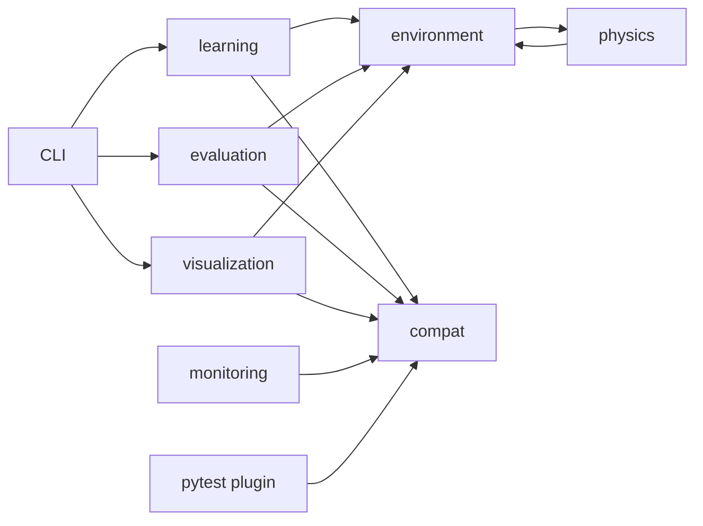

# Khảo sát đa nền tảng mma_ai sau gộp 006–009

- [Mục tiêu và phạm vi](#muc-tieu-va-pham-vi)
- [Điểm neo](#diem-neo)
- [Kiến trúc hiện hữu](#kien-truc-hien-huu)
- [Blast radius](#blast-radius)
- [Bản đồ hành vi](#ban-do-hanh-vi)
- [Nợ, cạm bẫy và phần chưa kiểm](#no-cam-bay-va-phan-chua-kiem)
  - [Tái khảo sát T8304693 — 2026-10-13](#tai-khao-sat-t8304693-2026-10-13)

## Mục tiêu và phạm vi

Track S: giao diện dòng lệnh (command-line interface, CLI), kiểm thử đầu cuối (end-to-end, E2E). Cập nhật khảo sát từ `629550d` sang HEAD `b82d69067510ceba011c75f11f006de5f18d8e32` [đo: `git rev-parse HEAD`]. Mục tiêu là cung cấp sự thật cho slice tài liệu 006–009, giữ mã nguồn chỉ đọc. Các mô tả cũ về nhập `resource` vô điều kiện, thiếu compat/CI được thay bằng hành vi hiện tại (`src/mma_ai/learning/resources.py:13`, `.github/workflows/ci.yml:17`). Giữ các ID điểm neo (anchor) F-001…F-011 và thêm neo mới; nhật ký vá (patch log) ở cuối.

Mọi truy vấn GitNexus đều có `repo: "/mnt/01DCE9A4D6522BD0/Project/AI/fighterl"`. Đã chạy `query(search_query="compat env_report capability_gate atomic_replace", limit=4)`, `context(name="build_environment_report", file_path="src/mma_ai/compat/env_report.py")`, context tương tự cho `pytest_collection_modifyitems` và `replace_atomic`, rồi `impact(target=<tên neo>, direction="upstream", includeTests=true)` cho cả ba. Các neo mới trả not found; impact có `risk=UNKNOWN`, không xác định được số ảnh hưởng. `api_impact(file=<ba tệp neo>)` trả No routes cho từng tệp. Chỉ mục cũ 93 commit, `symbols_query.py --outline src/mma_ai/compat/env_report.py --max-tokens 600` từ chối (bc26226 ≠ HEAD). Đã xuống `git grep -nE 'def |class ' -- <tệp>` và `git grep -nE 'replace_atomic|write_text_atomic|write_bytes_atomic' -- src/mma_ai`, xác nhận bằng `nl -ba` trên HEAD. Không dựng lại chỉ mục dùng chung.

## Điểm neo

| Điểm neo | Vai trò | Bằng chứng `file:line` hoặc truy vấn |
|---|---|---|
| F-001 | service — đo bộ nhớ | `src/mma_ai/learning/resources.py:78` chuyển sang `peak_ram_mb`; nhập compat tại dòng 13. REVIEW: thay đổi hành vi (business change) — không còn chặn Windows bằng import resource ở đây. |
| F-002 | service — ghép hồ sơ (manifest) | `src/mma_ai/learning/manifest.py:366` lấy tài nguyên khi không được cấp; writer hiện dùng compat tại dòng 503. |
| F-003 | service — dò màn hình | `src/mma_ai/visualization/display.py:34`; lớp đại diện (facade) compat tại `src/mma_ai/compat/display.py:82`. REVIEW: thay đổi hành vi (business change). |
| F-004 | controller — viewer train | `src/mma_ai/monitoring/viewer3d.py:49` dò display qua compat; nhập viewer lười tại dòng 93. REVIEW: thay đổi hành vi (business change). |
| F-005 | controller — benchmark | `src/mma_ai/learning/benchmark.py:144` dùng probe_display; ghi nguyên tử tại dòng 237. REVIEW: thay đổi hành vi (business change). |
| F-006 | service — thư mục chạy | `src/mma_ai/learning/run_dir.py:19`; kiểm đường dẫn hỗ trợ nhiều hệ tại `src/mma_ai/compat/pathrules.py:12`. |
| F-007 | repository — ghi tệp | `src/mma_ai/learning/checkpoint.py:31` nhập writer compat; điểm thay nguyên tử `src/mma_ai/compat/fsio.py:78`. REVIEW: thay đổi hành vi (business change). |
| F-008 | controller — train CLI | `src/mma_ai/learning/cli.py:231`; sinh UI ở dòng 141. |
| F-009 | controller — evaluate CLI | `src/mma_ai/evaluation/cli.py:190`; runner kiểm chia tập tại `src/mma_ai/evaluation/runner.py:330`. |
| F-010 | controller — replay/demo CLI | `src/mma_ai/visualization/cli.py:28`; `run_replay` tại `src/mma_ai/visualization/replay.py:189`. |
| F-011 | schema — đóng gói và CI | `pyproject.toml:9` Python 3.11–3.12; `.github/workflows/ci.yml:17` khai ma trận. REVIEW: thay đổi hành vi (business change) — CI đã có mã. |
| F-012 | controller — báo cáo môi trường | `src/mma_ai/compat/env_report.py:111`; CLI tại dòng 232. |
| F-013 | controller — plugin cổng năng lực | `tests/unit/capability_gate.py:118`; `conftest.py:11` nạp plugin. |
| F-014 | schema — hồ sơ nền tảng | `src/mma_ai/compat/platform_info.py:38` dò hệ điều hành/kiến trúc. |

## Kiến trúc hiện hữu

| Từ | Quan hệ | Đến |
|---|---|---|
| learning | đo RAM/ghi checkpoint | compat (`src/mma_ai/learning/resources.py:13`, `src/mma_ai/learning/checkpoint.py:31`). |
| visualization | facade dò display/ghi episode | compat (`src/mma_ai/visualization/display.py:34`, `src/mma_ai/visualization/episode.py:30`). |
| monitoring | dò display/ghi UI | compat (`src/mma_ai/monitoring/viewer3d.py:49`, `src/mma_ai/monitoring/cli.py:23`). |
| evaluation | ghi report | compat (`src/mma_ai/evaluation/report.py:435`). |
| environment ↔ physics | môi trường nhập model/simulator; simulator nhập lỗi environment | `src/mma_ai/environment/single_agent.py:37`, `src/mma_ai/physics/simulator.py:18`. |
| pytest plugin | dò platform/display/symlink/CUDA/xdist/git | `tests/unit/capability_gate.py:78`. |

| Cụm | Tệp chính (primary) | Dùng chung (shared) | Lý do |
|---|---|---|---|
| Mô phỏng | physics, environment | learning/evaluation/visualization | Biên Gymnasium và MuJoCo (`src/mma_ai/environment/single_agent.py:23`). |
| Học/đánh giá/phát lại | learning, evaluation, visualization | environment, checkpoint, compat | Chia theo trách nhiệm, có phụ thuộc chéo (`src/mma_ai/evaluation/runner.py:37`). |
| Quan sát | monitoring | progress.json, compat | HTTP đọc ảnh tiến trình và viewer con (`src/mma_ai/monitoring/dashboard.py:406`, `src/mma_ai/monitoring/cli.py:30`). |
| Tương thích | compat | mọi writer/display/RAM, plugin | Hạ tầng dùng chung, không sở hữu nghiệp vụ (`src/mma_ai/compat/fsio.py:78`). |

Xếp hạng bằng đồ thị (graph) mới cho compat là CHƯA KIỂM vì thiếu neo. Không giữ con số khảo sát cũ thành số HEAD; các phép impact CLI còn trả dữ liệu cũ được ghi ở [khảo sát tài liệu](mma-ai-project-docs.md). Không áp luật phân tầng một chiều lên các package vì có cạnh physics→environment thật (`src/mma_ai/physics/simulator.py:18`). Đề xuất stack lượt T8304693 bỏ khối preset: các package chia trách nhiệm nhưng không có lớp kiến trúc một chiều đủ rõ để khai luật cấm nhập. Hình dạng preset đã đối chiếu `presets/stacks/python-fastapi.yml`; không gán router FastAPI hoặc lớp ORM cho HTTP stdlib tại `src/mma_ai/monitoring/dashboard.py:338`.

## Blast radius

Phạm vi ảnh hưởng (blast radius) được chốt bằng dòng mã hiện tại; đồ thị thiếu neo được ghi rõ là UNKNOWN.

| Neo / thay đổi | Callers/callees | Test cần đối chiếu | Rủi ro |
|---|---|---|---|
| F-001 keep | Trực tiếp resources→memory (`src/mma_ai/learning/resources.py:13`); gián tiếp manifest/benchmark (`src/mma_ai/learning/manifest.py:366`). Impact peak_ram_mb chưa có chỉ mục HEAD. | `tests/unit/test_compat_memory.py`, `tests/integration/test_ram_real_measure.py`. | RAM khác đơn vị theo OS; chưa kiểm máy native. |
| F-003…F-005 keep | Trực tiếp display facade, View3D, benchmark→compat; gián tiếp replay/train UI (neo ở bảng). Impact build_environment_report không tìm được, không suy là không có callers. | `tests/unit/test_compat_display.py`, `tests/integration/test_display_consumers_agree.py`, `tests/integration/test_replay_viewer_real.py:207`. | Probe thành công không đảm bảo vòng viewer hoàn tất. |
| F-007 keep | Trực tiếp writer: `src/mma_ai/learning/checkpoint.py:339`, `src/mma_ai/learning/manifest.py:503`, `src/mma_ai/learning/progress.py:89`, `src/mma_ai/learning/benchmark.py:237`, `src/mma_ai/visualization/episode.py:545`, `src/mma_ai/evaluation/report.py:435`, `src/mma_ai/monitoring/cli.py:121`, `src/mma_ai/environment/verify_clean_install.py:203`. Impact replace_atomic trả not found. | `tests/unit/test_compat_fsio.py`, `tests/integration/test_atomic_replace_locked_windows.py`. | Mô phỏng khóa Windows không chứng minh khóa thật trên Windows. |
| F-012/F-013 keep; docs add/change | F-012→capabilities; F-013→dò năng lực và loại item (`tests/unit/capability_gate.py:142`). Context/impact không có các neo. | `tests/unit/test_env_report.py:119`, `tests/integration/test_check_env_cli.py:24`, `tests/unit/test_capability_gate.py:255`, E2E docs. | Tài liệu nhầm cảnh báo với lỗi hoặc bị loại với đạt. |
| F-011 keep | YAML có 6 cấu hình test; plugin nạp chung từ conftest. api_impact không phát hiện route trong ba tệp compat/plugin đã hỏi. | `tests/integration/test_ci_workflow.py`; `.github/workflows/ci.yml:42`. | Kiểm tĩnh workflow không bằng chạy GitHub Actions. |

Không thay route hay tải trọng dữ liệu (payload) trong lượt này. Hai trường hợp biên (edge case) phải nêu trong guide: archive không có .git loại test lịch sử (`tests/unit/test_capability_gate.py:255`); không có màn hình/torch chỉ cảnh báo khi env_report vẫn đạt (`src/mma_ai/compat/env_report.py:155`, `src/mma_ai/compat/env_report.py:175`). Phép quét route thủ công tìm HTTP dashboard thật tại `src/mma_ai/monitoring/dashboard.py:391`; đồ thị No routes ở các CLI không chứng minh toàn repo không có HTTP.

## Bản đồ hành vi

| Luồng | Đầu vào / đầu ra / lỗi thật | Bằng chứng |
|---|---|---|
| env_report | Không cờ: văn bản; `--json`: một đối tượng JSON stdout, thông báo stderr. Cờ khác trả 2; overall fail trả 1, còn lại 0. | `src/mma_ai/compat/env_report.py:232`. |
| JSON môi trường | schema_version 1.0.0; os, python, packages, torch_device, capabilities, checks, overall. Thiếu torch hoặc display chỉ warn; Python ngoài 3.11–3.12/gói bắt buộc thiếu có fail. | `src/mma_ai/compat/env_report.py:139`, `src/mma_ai/compat/env_report.py:155`, `src/mma_ai/compat/env_report.py:198`. |
| Ghi nguyên tử (atomic write) | Tệp tạm cùng thư mục, flush/fsync/đóng trước replace; Windows PermissionError thử lại (retry) tối đa 5 lần mặc định; hệ khác không retry; dọn tạm khi lỗi. | `src/mma_ai/compat/fsio.py:78`, `src/mma_ai/compat/fsio.py:112`. |
| Văn bản | UTF-8 không BOM, chuẩn hóa LF; AtomicWriteError chứa đích và Nguyên nhân gốc. | `src/mma_ai/compat/fsio.py:146`, `src/mma_ai/compat/fsio.py:40`. |
| Thu thập pytest | Marker năng lực phải có reason không rỗng; thiếu reason gây UsageError. Thiếu năng lực thì deselection (loại khi thu thập), không thêm skip/xfail. Marker display chỉ cho phép fixture giữ display, không tự yêu cầu năng lực. | `tests/unit/capability_gate.py:118`, `tests/unit/capability_gate.py:134`, `conftest.py:23`. |
| Báo cáo loại test | `--capability-report <path>` ghi collected/deselected/ratio/items; terminal in X/Y; mặc định tỷ lệ tối đa 0.05, vượt ngưỡng làm session fail. | `tests/unit/capability_gate.py:43`, `tests/unit/capability_gate.py:147`, `tests/unit/capability_gate.py:180`, `tests/unit/capability_gate.py:192`. |
| Git archive | `git rev-parse --is-inside-work-tree` từ gốc repo, thời hạn chờ (timeout) 5 giây; không git/không .git/lỗi hoặc timeout ⇒ không có năng lực. Chỉ kiểm ở trong worktree, không chứng minh đủ lịch sử mọi commit. | `tests/unit/capability_gate.py:83`. |

| Marker (nhãn năng lực) | Phép dò | Bằng chứng |
|---|---|---|
| requires_display | probe_display.available | `tests/unit/capability_gate.py:94`. |
| requires_cuda | torch.cuda.is_available, lỗi trả False | `tests/unit/capability_gate.py:98`. |
| requires_symlink | tạo liên kết tượng trưng (symlink) thật trong thư mục tạm | `tests/unit/capability_gate.py:104`, `src/mma_ai/compat/capabilities.py:38`. |
| windows_only | platform.kind == windows | `tests/unit/capability_gate.py:109`. |
| requires_xdist | find_spec("xdist") | `tests/unit/capability_gate.py:92`. |
| requires_git_history | phép dò git ở trên | `tests/unit/capability_gate.py:83`. |

Các marker bổ sung `display`, `posix_only`, `linux_only`, `macos_only` đã đăng ký tại `tests/unit/capability_gate.py:16`; không bịa marker mới. INV-002 tài liệu đã đánh marker ở `tests/e2e/test_008_docs_entrypoints.py:118`, thân giữ nguyên. CI cài extras rồi chạy env_report/pytest/E2E/lint/mypy tại `.github/workflows/ci.yml:31`, dòng 33, 42, 51, 69, 71.

## Nợ, cạm bẫy và phần chưa kiểm

- ĐÃ KIỂM Linux theo bảng QA; CHƯA KIỂM Windows 11, macOS, CUDA, WSL2 thật và sáu ô CI thật (`.ai/runs/run-20261012-0ecb0c/reports/qa-006-crossplatform.md:55`, dòng 62, 66, 71, 73). Kiểm logic bằng hồ sơ tiêm không thay bằng chứng máy native.
- `PlatformProfile.tested` được suy từ OS/kiến trúc; Windows/macOS vẫn có thể True (`src/mma_ai/compat/platform_info.py:106`, `src/mma_ai/compat/platform_info.py:119`). `overall=ok` không chứng nhận huấn luyện/CUDA/viewer/CI đã chạy.
- Hạn chế đã biết (Known-broken): helper viewer E2E có phụ thuộc POSIX `killpg`, `getpgid`, `ps -eo` (`tests/e2e/test_007_viewer_entrypoint.py:57`, dòng 63, 75, 103). CHƯA KIỂM chạy native Windows; không sửa helper ngoài slice docs.
- Comment workflow còn nói chưa remote (`.github/workflows/ci.yml:10`); đây là ghi chú lịch sử ngoài phạm vi sửa, không dùng làm sự thật sau push.
- Chỉ mục GitNexus cũ là điểm mù; số PageRank/caller HEAD của compat là CHƯA KIỂM. Dòng mã và báo cáo QA là căn cứ chính, không tự dựng graph trong cây chung.
- Tự chốt (D-0003): dùng trạng thái QA thay cho cờ tested khi viết cam kết — lý do: mã F-014 phân loại cấu hình, QA phân biệt rõ ĐÃ/CHƯA KIỂM.
- Nhật ký vá 2026-10-13: F-001/F-003/F-004/F-005/F-007/F-011 đổi hành vi sau gộp, đánh REVIEW; F-008/F-009 dịch dòng, giữ trách nhiệm; thêm F-012…F-014. Dẫn chứng đã cập nhật theo khai báo tại HEAD; kế hoạch sửa facade cũ không còn là việc cần xây.

- Đo HEAD trong khảo sát T8048729 trước: cổng mypy và E2E rộng đỏ, cổng nháp tests xanh nhưng có bỏ qua phụ thuộc; kết quả chi tiết ở [báo cáo cổng lịch sử](../../.ai/runs/spec/reports/surveyor-docs.md). Không diễn giải thành toàn hệ đã được kiểm xanh.

### Tái khảo sát T8304693 — 2026-10-13

Giữ nội dung và ID khảo sát đang có trong cây dùng chung; xác nhận lại trên cùng HEAD `b82d69067510ceba011c75f11f006de5f18d8e32` [đo: `git rev-parse HEAD`]. Kết quả cổng của lượt trước ở báo cáo T8048729 trên; phép đo mới ở [báo cáo T8304693](../../.ai/runs/spec/reports/surveyor-gates-T8304693.md). Không dùng mtime thay cho cập nhật nội dung.

Đã chạy lại `query(search_query="env_report capabilities git_history pytest_collection_modifyitems", limit=3, max_symbols=5)` và `context(name=<symbol>, file_path=<tệp>)` cho F-007 `replace_atomic`, F-012 `build_environment_report`, F-013 `pytest_collection_modifyitems`: cả ba neo mới không có trong chỉ mục chậm 93 commit. Với mọi lời gọi, `repo="/mnt/01DCE9A4D6522BD0/Project/AI/fighterl"`. `impact(target=<symbol>, file_path=<tệp>, direction="upstream", maxDepth=2, includeTests=true)` trả UNKNOWN; `api_impact(file=<tệp>)` không thấy tuyến trong đồ thị. Đã tra `symbols_query.py --outline src/mma_ai/compat/env_report.py --max-tokens 600`, rồi xuống `git grep -nE '^(class |def |from |import )' -- src/mma_ai/compat tests/unit/capability_gate.py conftest.py` và đọc đúng đoạn HEAD. Kết quả âm của đồ thị không chứng minh không có phụ thuộc.

| Neo | Tệp truyền vào `impact` | Trực tiếp / gián tiếp ở chỉ mục cũ |
|---|---|---|
| F-001 | `src/mma_ai/learning/resources.py` | 1 / 3 |
| F-002 | `src/mma_ai/learning/manifest.py` | 3 / 1 |
| F-003 | `src/mma_ai/visualization/display.py` | 1 / 1 |
| F-004 | `src/mma_ai/monitoring/viewer3d.py` | 1 / 0 |
| F-005 | `src/mma_ai/learning/benchmark.py` | 0 / 0; risk UNKNOWN |
| F-006 | `src/mma_ai/learning/run_dir.py` | 1 / 0 |
| F-007 | `src/mma_ai/learning/checkpoint.py` | 7 / 4 |
| F-008…F-011 | CLI train/evaluate/replay và `pyproject.toml` | 0 / 0; risk UNKNOWN |
| F-014 | `src/mma_ai/compat/platform_info.py` | Không tìm thấy |

Các số trên là kết quả `impact(target=<tệp trong bảng>, direction="upstream", maxDepth=2, includeTests=true, summaryOnly=true)` đã chạy, chỉ dùng định hướng đọc. Đã chạy `api_impact(file=<từng tệp trong bảng>)`: tất cả trả không thấy tuyến. Phạm vi test và consumer hiện tại vẫn theo bảng Blast radius và căn cứ HEAD: checkpoint ghi qua compat (`src/mma_ai/learning/checkpoint.py:339`), report đánh giá (`src/mma_ai/evaluation/report.py:435`), progress (`src/mma_ai/learning/progress.py:89`), episode (`src/mma_ai/visualization/episode.py:545`).

Đối chiếu hành vi biên (edge case): `env_report --json` xuất JSON vào thiết bị xuất chuẩn (stdout), thông báo hoàn tất vào thiết bị xuất lỗi chuẩn (stderr) và exit 0/1 theo `overall`; cờ lạ exit 2 (`src/mma_ai/compat/env_report.py:232`). `requires_git_history` chỉ dò worktree bằng git, không đo độ sâu lịch sử (`tests/unit/capability_gate.py:83`). CHƯA KIỂM trường hợp archive nằm trong kho khác: phép dò không xác nhận đúng gốc, nên không phát biểu mọi archive luôn bị loại; test archive độc lập thật nằm ở `tests/unit/test_capability_gate.py:255`.
