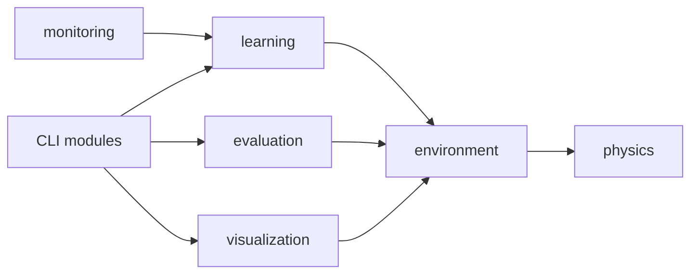

# Khảo sát đa nền tảng mma_ai

- [Mục tiêu và phạm vi](#muc-tieu-va-pham-vi)
- [Điểm neo](#diem-neo)
- [Kiến trúc hiện hữu](#kien-truc-hien-huu)
- [Blast radius](#blast-radius)
- [Bản đồ hành vi](#ban-do-hanh-vi)
- [Nợ, cạm bẫy và phần chưa kiểm](#no-cam-bay-va-phan-chua-kiem)

> Đích: `docs/00-survey/mma-ai-cross-platform.md`. Không sửa mã nguồn khi lập tài liệu này.

## Mục tiêu và phạm vi

Khảo sát này chuẩn bị đặc tả đa nền tảng (cross-platform) cho CLI của `mma_ai` trên Windows gốc, Linux/WSL2 và macOS: train, evaluate, replay/demo và benchmark; gồm đo RAM, dò màn hình, đường dẫn/ghi tệp, cài đặt, kiểm thử và CI. Nguồn được khảo sát là HEAD `ff7b568`; worktree dùng chung đang có các xoá staged đối với CLI evaluation/replay nên những phần đó được đọc từ `HEAD:<file>` và được gắn cờ phối hợp.

- Tự chốt: coi Windows gốc, WSL2 và macOS đều là đích nghiệm thu — yêu cầu chưa xác định môi trường Windows chính, nên đặc tả sau phải hỏi lại mức ưu tiên/thiết bị CUDA thay vì bỏ một nhánh.
- GitNexus đã được gọi với `repo: "/mnt/01DCE9A4D6522BD0/Project/AI/fighterl"` cho `query`, `context`, `impact` và `api_impact`; server trả `Repository ... not found. Available: skill_ai`. Chỉ mục `.ai/index` cũng cũ (HEAD index `38204a4`, HEAD khảo sát `ff7b568`), do đó các quan hệ dưới đây dùng `rg`/đọc symbol theo dòng mã và ghi rõ giới hạn này.

## Điểm neo

| Điểm neo | Vai trò | Bằng chứng `file:line` hoặc truy vấn |
|---|---|---|
| F-001 | service — đo tài nguyên | `src/mma_ai/learning/resources.py:8` nhập `resource` vô điều kiện; `_peak_ram_mb` lấy `ru_maxrss / 1024` tại `src/mma_ai/learning/resources.py:77`; `collect_resources` công bố `ram_peak_mb` tại `src/mma_ai/learning/resources.py:90`. |
| F-002 | service — ghép manifest | Không có đầu vào resources thì `build_manifest` nhập lười và gọi F-001: `src/mma_ai/learning/manifest.py:362`. |
| F-003 | service — dò display (màn hình) | `display_available()` khởi tạo GLFW thực tại `src/mma_ai/visualization/display.py:34`, nhưng chẩn đoán chỉ đọc `DISPLAY`/`WAYLAND_DISPLAY` tại `src/mma_ai/visualization/display.py:80`. |
| F-004 | controller — viewer train | `View3D.has_display()` chỉ kiểm hai biến POSIX tại `src/mma_ai/monitoring/viewer3d.py:48`; `run()` thoát trước khi nhập MuJoCo viewer tại `src/mma_ai/monitoring/viewer3d.py:86`. |
| F-005 | controller — benchmark | `evaluate_view3d_status()` cũng dùng hai biến POSIX tại `src/mma_ai/learning/benchmark.py:139`; ghi báo cáo UTF-8 bằng `os.replace` tại `src/mma_ai/learning/benchmark.py:211`. |
| F-006 | service — thư mục run | `create_run_dir()` nối trực tiếp `stage` vào `Path` và tạo thư mục loại trừ va chạm tại `src/mma_ai/learning/run_dir.py:19`. |
| F-007 | service — ghi nguyên tử | Checkpoint dùng `.tmp`, `fsync`, `os.replace` tại `src/mma_ai/learning/checkpoint.py:338`; manifest làm tương tự tại `src/mma_ai/learning/manifest.py:502`; episode đặt UTF-8, `ensure_ascii=False`, `fsync`, `os.replace` tại `src/mma_ai/visualization/episode.py:713`. |
| F-008 | controller — train CLI | `learning.cli` sinh UI qua `sys.executable -m mma_ai.monitoring.cli`, không ghép shell command, tại `src/mma_ai/learning/cli.py:150`. |
| F-009 | controller — evaluate CLI | HEAD có `main()` tại `HEAD:src/mma_ai/evaluation/cli.py:189` và điều phối đánh giá tại `HEAD:src/mma_ai/evaluation/runner.py:192`; các tệp này hiện bị xoá staged trong worktree dùng chung. |
| F-010 | controller — replay/demo CLI | HEAD có `run_replay()` tại `HEAD:src/mma_ai/visualization/replay.py:189`, gọi F-003 trước viewer tại `HEAD:src/mma_ai/visualization/replay.py:452`, và CLI mỏng tại `HEAD:src/mma_ai/visualization/cli.py:25`; các tệp này hiện bị xoá staged trong worktree dùng chung. |
| F-011 | packaging/CI | Python được giới hạn `>=3.11,<3.13` và base dependencies gồm MuJoCo/myo-sim tại `pyproject.toml:5`; marker test chỉ nói `DISPLAY`/`WAYLAND_DISPLAY` tại `pyproject.toml:48`; `find scripts` và `find .github` không tìm thấy tệp, nên `scripts/check_env.py` và workflow CI chưa tồn tại. |

## Kiến trúc hiện hữu

| Từ | Quan hệ | Đến |
|---|---|---|
| `learning.trainer` | dùng lỗi môi trường và các service learning | `environment`, `learning.*` — `src/mma_ai/learning/trainer.py:19` |
| `environment.single_agent` | nạp model/simulator | `physics` — `src/mma_ai/environment/single_agent.py:37` |
| `evaluation.rollout` | chạy môi trường | `environment` — `src/mma_ai/evaluation/rollout.py:21` |
| `visualization.recorder` | đọc trạng thái môi trường | `environment` — `src/mma_ai/visualization/recorder.py:25` |
| `learning.cli` | sinh tiến trình UI module-mode | `monitoring.cli` — `src/mma_ai/learning/cli.py:150` |

| Cụm | Tệp primary | Shared (tham chiếu, không sở hữu) | Gộp/tách vì |
|---|---|---|---|
| Mô phỏng | `physics/*.py`, `environment/*.py` | `learning`, `evaluation`, `visualization` | Environment là biên Gym/MuJoCo dùng chung. |
| Huấn luyện | `learning/*.py` | `environment`, `monitoring` | CLI, tài nguyên, persistence và PPO cùng bounded context. |
| Đánh giá | `evaluation/*.py` | `environment`, `physics`, checkpoint | Độc lập theo package; source CLI/runner hiện cần phối hợp vì xoá staged. |
| Hiển thị/phát lại | `visualization/*.py`, `monitoring/*.py` | `environment`, `learning` | Có hai viewer khác nhau nhưng cùng phụ thuộc khả năng màn hình. |

Xếp hạng định lượng bằng GitNexus CHƯA KIỂM vì repo chưa được index; bảng trên chỉ khẳng định các cạnh import trực tiếp. Các writer dùng `Path` và encoding UTF-8 tại F-007, nhưng chưa thành một lớp tương thích (compatibility layer) duy nhất.

### Known-broken và đường hiện đại hoá

- F-001 chặn Windows ngay lúc import; phép chia RAM hiện chỉ đúng Linux KiB→MiB và sai macOS byte→MiB (`src/mma_ai/learning/resources.py:8`, `src/mma_ai/learning/resources.py:77`).
- F-004/F-005 xem Windows/macOS không có `DISPLAY` là không có màn hình, làm viewer 3D bị tắt dù GLFW có thể khởi tạo (`src/mma_ai/monitoring/viewer3d.py:48`, `src/mma_ai/learning/benchmark.py:146`).
- Mặt tiền (strangler facade) phù hợp là một module platform nhỏ cho RAM/display/capability; characterization test (kiểm thử đặc trưng) phải khoá Linux trước, rồi chuyển F-001/F-003/F-004/F-005 từng điểm. Rollback là giữ implementation Linux hiện tại sau facade và chỉ bật nhánh OS mới bằng test mock + CI green.

## Blast radius

GitNexus `impact`/`api_impact` đã chạy cho `collect_resources`, `display_available`, `write_manifest`, `View3D` với repo tuyệt đối nhưng không thể trả đồ thị vì server không có repo. Phân tầng sau là từ import/call theo dòng mã, không phải đồ thị hoàn chỉnh.

| Thay đổi | Callers/callees | Test liên quan | Rủi ro |
|---|---|---|---|
| F-001 compatibility RAM | Tầng 1: F-002 gọi `collect_resources` (`src/mma_ai/learning/manifest.py:362`); benchmark đọc `ram_peak_mb` (`src/mma_ai/learning/benchmark.py:120`). Tầng 2: train/evaluate ghi manifest. | `tests/unit/test_resources.py:31`; `tests/unit/test_manifest.py`; `tests/integration/test_train_cli.py`. | Windows import failure; macOS báo RAM sai đơn vị. |
| F-003/F-004/F-005 display probe | Tầng 1: replay HEAD gọi F-003; View3D guard (`src/mma_ai/monitoring/viewer3d.py:86`); benchmark F-005. Tầng 2: train spawn UI F-008. | `tests/unit/test_display.py:51`; `tests/integration/test_viewer3d.py:64`; `tests/integration/test_train_headless.py`. | Có thể vô tình mở viewer trong headless hoặc chặn Windows/macOS có display. |
| F-006/F-007 filesystem | Tầng 1: checkpoint, manifest, progress (`src/mma_ai/learning/progress.py:82`), episode. Tầng 2: train/eval/replay artifacts. | `tests/unit/test_run_dir.py`; `tests/unit/test_checkpoint.py`; `tests/unit/test_episode.py`; `tests/unit/test_benchmark_logic.py:182`. | đường dẫn thoát root, symlink/ACL Windows, đích đang mở, Unicode/CRLF. |
| Packaging + CI | Toàn bộ suite qua `pyproject.toml:48`; clean install module entry tại `src/mma_ai/environment/verify_clean_install.py:203`. | bộ unit/integration/challenge/e2e; CI mới. | Không có xác minh native Windows/macOS; extra torch không phân loại CPU/CUDA. |

Chuỗi sửa dự kiến: `(1) platform facade — add`; `(2) F-001/F-003/F-004/F-005 — change`; `(3) filesystem guard F-006/F-007 — change`; `(4) tests theo OS và marker capability — add/change`; `(5) check_env, docs, CI — add`. Trước khi sửa, cần hai ca biên (edge case): Windows không có quyền tạo symlink phải báo capability/skip có chủ đích; Windows đích JSON đang mở phải giữ file cũ, dọn temp và trả lỗi có ngữ cảnh.

## Bản đồ hành vi

| Luồng CLI | Hành vi hiện tại | Bằng chứng | Tình trạng đa nền tảng |
|---|---|---|---|
| Train | `main()` tạo/sử dụng run dir, có thể spawn UI module-mode; manifest tự thu resources khi caller không cấp. | `src/mma_ai/learning/cli.py:230`; `src/mma_ai/learning/manifest.py:362`; `src/mma_ai/learning/cli.py:165`. | Windows fail qua F-001; UI/viewer tùy chọn sai guard F-004. |
| Benchmark | Đánh giá display bằng env POSIX và ghi JSON UTF-8 qua replace. | `src/mma_ai/learning/benchmark.py:139`; `src/mma_ai/learning/benchmark.py:220`. | Windows/macOS sai detection; atomic handling chưa test native. |
| Evaluate | CLI lấy checkpoint/config/out/repeats/seed/runs-dir; runner nạp JSON UTF-8 và xuất report nguyên tử theo mô tả module. | `HEAD:src/mma_ai/evaluation/cli.py:58`; `HEAD:src/mma_ai/evaluation/runner.py:128`; `HEAD:src/mma_ai/evaluation/runner.py:1`. | CHƯA KIỂM chạy trên Windows/macOS; source đang xoá staged, phải phục hồi/phối hợp trước implementation. |
| Replay/demo | Parse `--episode`/`--checkpoint`/`--headless`; không headless thì gọi display check, episode writer dùng atomic replace. | `HEAD:src/mma_ai/visualization/replay.py:93`; `HEAD:src/mma_ai/visualization/replay.py:452`; `src/mma_ai/visualization/episode.py:678`. | Native Windows/macOS bị ảnh hưởng F-003; source runner đang xoá staged. |
| Clean install | Có module verifier, không có shell script. | `src/mma_ai/environment/verify_clean_install.py:203`; `find scripts` không có thư mục. | Không có `scripts/check_env.py`, hướng dẫn uv/pip hay kiểm OS. |

## Nợ, cạm bẫy và phần chưa kiểm

- Test oversized set dùng `import resource` và `setrlimit`, lại đặt `xfail(strict=False)`: `tests/challenge/test_env_invariants.py:230`. Đây vừa không chạy Windows vừa che lỗi trái yêu cầu.
- Test symlink tạo liên kết trực tiếp, không có capability check: `tests/challenge/test_train_invariants.py:763`. Mã sản phẩm không có `symlink`/`lstat`/`is_symlink` (truy vấn `rg` chỉ trả test), còn `stage` có thể chứa `/` và hiện bị `xfail(strict=False)` tại `tests/challenge/test_train_invariants.py:783`.
- Test display chỉ bỏ `DISPLAY`/`WAYLAND_DISPLAY` (`conftest.py:17`; `tests/unit/test_display.py:51`), chưa mock platform Windows/macOS hay một capability native.
- Không có `.github/**` hay `scripts/**` tại thời điểm khảo sát; chưa có CI matrix, check_env, hướng dẫn Windows uv/pip, hay lệnh phân biệt torch CPU/CUDA.
- CHƯA KIỂM: Windows chính là native hay WSL2; có runner Windows/máy kiểm tay; CUDA Windows bắt buộc; macOS là support chạy đầy đủ hay chỉ import/không lỗi.
- CHƯA KIỂM: hành vi native MuJoCo/GLFW/myo-sim trên Windows và macOS; chỉ CI/thiết bị thật mới chứng minh được.
