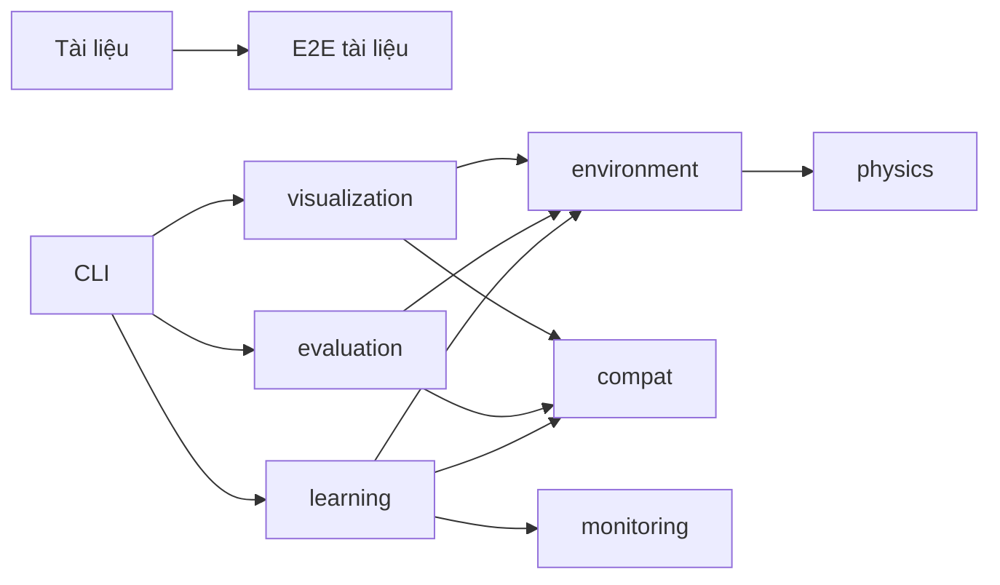

# Khảo sát bộ tài liệu dự án mma_ai sau gộp 006–009

- [Mục tiêu và phạm vi](#muc-tieu-va-pham-vi)
- [Điểm neo](#diem-neo)
- [Kiến trúc hiện hữu](#kien-truc-hien-huu)
- [Blast radius](#blast-radius)
- [Bản đồ hành vi](#ban-do-hanh-vi)
- [Nợ, cạm bẫy và phần chưa kiểm](#no-cam-bay-va-phan-chua-kiem)
  - [Tái khảo sát T8304693 — 2026-10-13](#tai-khao-sat-t8304693-2026-10-13)

## Mục tiêu và phạm vi

Track S: khảo sát chỉ đọc mã để đặc tả cập nhật README, CHANGELOG và hướng dẫn nền tảng sau gộp 006–009. Điểm vào (entry point) chính là giao diện dòng lệnh (command-line interface, CLI); kiểm thử đầu cuối (end-to-end, E2E) đọc trực tiếp tài liệu. Nguồn phạm vi là `docs/MAP.md:20`, `docs/MAP.md:21`, `docs/MAP.md:22`, `docs/MAP.md:23`. Mốc đo: `git rev-parse HEAD` trả `b82d69067510ceba011c75f11f006de5f18d8e32`; `git diff --stat 629550d..HEAD -- README.md CHANGELOG.md docs/guides conftest.py tests/e2e/test_008_docs_entrypoints.py` xác nhận các đầu ra trước đây đã được thêm và mã đã đổi.

- Tự chốt (D-0001): chỉ khảo sát và đề xuất, không thi công README/CHANGELOG/guides/test — lý do: đầu ra lượt này thuộc vai surveyor; các vai docs, qa, reviewer được phân ở `specs/008-project-docs/tasks.md:38`.
- Tự chốt (D-0002): giữ `status: draft` của 006 — lý do: `specs/006-cross-platform-support/spec.md:6` là trạng thái đặc tả, không phải bằng chứng mã chưa gộp; không có căn cứ bắt buộc đổi trong lượt khảo sát.

GitNexus dùng duy nhất `repo: "/mnt/01DCE9A4D6522BD0/Project/AI/fighterl"`. Đã chạy `query(search_query="training evaluation replay benchmark dashboard CLI", limit=4)`, `context(name="main", file_path="src/mma_ai/learning/cli.py")`, `impact(target="README.md", direction="both", depth=2, includeTests=true)`, tương tự cho `CHANGELOG.md` và `tests/e2e/test_008_docs_entrypoints.py`; ba impact trả `not found`, không phải không có ảnh hưởng. Đồ thị báo chậm 93 commit. `symbols_query.py --outline ... --max-tokens 1300` cho CLI train/evaluate/resources và replay bị từ chối vì chỉ mục `bc26226`; đã xuống `git grep -nE '^(class |def |from |import )' -- <tệp>` rồi đối chiếu đoạn mã bằng `nl -ba`. Không tự cập nhật chỉ mục trong cây dùng chung.

## Điểm neo

| Điểm neo | Vai trò | Bằng chứng `file:line` hoặc truy vấn |
|---|---|---|
| F-001 | ui — hiện trạng nền tảng README | `README.md:65`; câu cũ “đang được triển khai” tại `README.md:67`. |
| F-002 | ui — nhật ký thay đổi (changelog) | `CHANGELOG.md:5` trống; bản phát hành 0.1.0 bắt đầu tại `CHANGELOG.md:7`. |
| F-003 | ui — liên kết hướng dẫn | `README.md:69`; ba liên kết hiện hữu ở `README.md:72`. |
| F-004 | controller — điểm vào train | `scripts/train.py:6`; `src/mma_ai/learning/cli.py:231`. |
| F-005 | controller — điểm vào evaluate | `src/mma_ai/evaluation/cli.py:190`. |
| F-006 | controller — điểm vào replay/demo | `src/mma_ai/visualization/cli.py:28`. |
| F-007 | controller — điểm vào benchmark | `src/mma_ai/learning/benchmark.py:447`. |
| F-008 | controller — chẩn đoán môi trường | `src/mma_ai/compat/env_report.py:232`; tạo báo cáo ở `src/mma_ai/compat/env_report.py:111`. |
| F-009 | controller — cổng năng lực (capability gate) | `tests/unit/capability_gate.py:118`; plugin nạp ở `conftest.py:11`. |
| F-010 | schema — cam kết tài liệu trong E2E | `tests/e2e/test_008_docs_entrypoints.py:141` kiểm câu cũ; danh sách đúng ba guides ở `tests/e2e/test_008_docs_entrypoints.py:249`. |
| F-011 | schema — bằng chứng QA đa nền tảng | `.ai/runs/run-20261012-0ecb0c/reports/qa-006-crossplatform.md:55`. |
| F-012 | schema — cấu hình CI | `.github/workflows/ci.yml:17`; ba hệ điều hành × Python 3.11/3.12. |

## Kiến trúc hiện hữu

| Từ | Quan hệ | Đến |
|---|---|---|
| Tài liệu | E2E đọc UTF-8, so cờ và liên kết | `tests/e2e/test_008_docs_entrypoints.py:43`, `tests/e2e/test_008_docs_entrypoints.py:256`. |
| CLI train | gọi module learning, tạo môi trường và sinh UI | `scripts/train.py:6`, `src/mma_ai/learning/cli.py:141`; GitNexus context F-004 trả `make_env`, `Trainer.run`, `_spawn_ui_process`. |
| evaluation | nhập environment, kiểm chia tập trước chạy | `src/mma_ai/evaluation/runner.py:37`, `src/mma_ai/evaluation/runner.py:330`. |
| environment | nhập physics | `src/mma_ai/environment/single_agent.py:37`. |
| physics | nhập lỗi environment: không phải tầng một chiều nghiêm ngặt | `src/mma_ai/physics/simulator.py:18`. |
| learning/evaluation/visualization | ghi qua compat | `src/mma_ai/learning/checkpoint.py:31`, `src/mma_ai/evaluation/report.py:435`, `src/mma_ai/visualization/episode.py:30`. |

| Cụm | Tệp chính (primary) | Dùng chung (shared) | Lý do |
|---|---|---|---|
| Tài liệu sản phẩm | README, CHANGELOG, guides | CLI, specs, QA | E2E đọc tài liệu và chạy trợ giúp thật (`tests/e2e/test_008_docs_entrypoints.py:48`). |
| QA tài liệu | `tests/e2e/test_008_docs_entrypoints.py` | marker và plugin | INV-002 dựa lịch sử git (`tests/e2e/test_008_docs_entrypoints.py:118`). |
| Đa nền tảng | `src/mma_ai/compat/` | writer/display/RAM | RAM nay gọi compat (`src/mma_ai/learning/resources.py:13`). |

Xếp hạng ảnh hưởng trong các neo đo được, không suy ra cho toàn repo: `impact(target="src/mma_ai/visualization/replay.py", direction="both", depth=2, includeTests=true)` trả 14 nút trực tiếp + 11 gián tiếp; lệnh tương tự cho `src/mma_ai/evaluation/cli.py` trả 4 + 16. Đây là đồ thị cũ dùng định hướng, không phải số lượng ảnh hưởng của HEAD. Xếp hạng mới cho compat/README là CHƯA KIỂM vì đồ thị không có các neo ấy.

## Blast radius

Phạm vi ảnh hưởng (blast radius) của tài liệu có bằng chứng trực tiếp và truy vấn đồ thị; đồ thị thiếu neo được ghi rõ thay vì kết luận phạm vi bằng 0.

| Thay đổi | Callers/callees | Test liên quan | Rủi ro |
|---|---|---|---|
| F-001 change: mô tả đã gộp, chỉ Linux đã kiểm | Trực tiếp: F-010 tách mục README và kiểm câu (`tests/e2e/test_008_docs_entrypoints.py:143`); impact README trả not found. Gián tiếp: F-011 chứng minh giới hạn kiểm. | `tests/e2e/test_008_docs_entrypoints.py:141`. | Gán draft thành chưa có mã hoặc dùng `os.tested` thành bằng chứng kiểm định chất lượng (quality assurance, QA). |
| F-002 change: Added/Changed 006–009, giữ 0.1.0 | Trực tiếp: kiểm mục/version (`tests/e2e/test_008_docs_entrypoints.py:239`); impact CHANGELOG trả not found. | `tests/e2e/test_008_docs_entrypoints.py:213`, `tests/e2e/test_008_docs_entrypoints.py:256`. | Ghi sai spec hoặc đổi bản phát hành cũ. |
| F-003 add: `docs/guides/platforms.md`, liên kết README | Trực tiếp: danh sách guides đúng ba tệp (`tests/e2e/test_008_docs_entrypoints.py:249`), kiểm liên kết ở dòng 256; impact E2E trả not found. | Cập nhật kỳ vọng chính xác bốn tệp; thêm kiểm liên kết, lệnh và giới hạn của guide mới. | Chỉ sửa assert nền tảng sẽ bỏ sót test cấu trúc. |
| F-008/F-009 keep: mô tả chẩn đoán và loại test | env_report probe năng lực; pytest loại khi thu thập tại `tests/unit/capability_gate.py:142`; context/impact các neo compat trả not found (xem khảo sát đa nền tảng). | `tests/unit/test_env_report.py:119`, `tests/integration/test_check_env_cli.py:24`, `tests/unit/test_capability_gate.py:255`. | Nhầm bị loại với PASS/skip hoặc báo cáo ok với QA native. |
| F-004…F-007 keep: ba guides cũ | CLI/cờ vẫn khớp `docs/guides/training.md:24`, `docs/guides/evaluation.md:24`, `docs/guides/replay-demo.md:24`; context/impact CLI ở trên. | `tests/e2e/test_008_docs_entrypoints.py:201`; integration train/evaluate/replay. | Thêm sửa không có căn cứ vào guides cũ. |

Không sửa thân INV-002 (`tests/e2e/test_008_docs_entrypoints.py:119`). `GUIDES` tại dòng 22 tham gia tập `allowed` tại dòng 123: thêm platforms vào tập này sẽ đổi phép kiểm lịch sử. Đề xuất QA giữ `GUIDES` lịch sử và thêm danh sách riêng cho cấu trúc/liên kết guides mới; giữ mọi assert kiểm lệnh/cờ còn lại, không thêm skip/xfail. `DOCUMENTS` tại dòng 23 cần bao phủ guide mới; bảng lệnh tại dòng 29 cần đối chiếu env_report nếu kiểm lệnh mới. Đây là công việc được đặc tả, chưa sửa test trong survey.

Đồng thay đổi (co-change): `git log -5 --format='%h %s' -- README.md CHANGELOG.md tests/e2e/test_008_docs_entrypoints.py` trả `98366d6` thêm CHANGELOG/guides và `bfa5cbb` thêm E2E, sau đó `eeb568d` thêm marker lịch sử git. Quan hệ này giải thích QA phải đi cùng cập nhật docs; không dùng approval cũ cho thay đổi mới (`.ai/runs/run-20261011-f29432/reports/reviewer-docs-check.md:12`).

Hai trường hợp biên (edge case): bản archive không có `.git` phải loại INV-002 có báo cáo (`tests/unit/test_capability_gate.py:255`); máy thiếu torch vẫn có thể env_report exit 0 với cảnh báo (`src/mma_ai/compat/env_report.py:155`). Không được diễn giải cả hai là mọi tính năng đã chạy thành công. `api_impact(file="README.md")` và `api_impact(file="src/mma_ai/learning/cli.py")` trả không có route cho các tệp ấy; dashboard thật vẫn có HTTP tại `src/mma_ai/monitoring/dashboard.py:391`.

## Bản đồ hành vi

| Luồng | Hành vi và giới hạn thật | Bằng chứng |
|---|---|---|
| Train | `--stage elbow`, `--seed`, `--config`, `--total-steps`, `--resume`, `--runs-dir`, `--ui web|none`, `--ui-port`, `--view3d`; wrapper chuyển module. | `src/mma_ai/learning/cli.py:55`, `scripts/train.py:6`. |
| Evaluate | `--checkpoint` bắt buộc; ngoài run cần `--out`; có config/repeats/eval-seed/runs-dir; chia tập được kiểm trước rollout (chạy tập phim). | `src/mma_ai/evaluation/cli.py:59`, `src/mma_ai/evaluation/runner.py:330`. |
| Replay/demo | Chính xác một trong episode/checkpoint; headless xuất tóm tắt JSON; thiếu cả hai/đủ cả hai trả 2; CLI có xử lý gợi ý macOS trong mã, chưa chứng minh native. | `src/mma_ai/visualization/replay.py:93`, `src/mma_ai/visualization/replay.py:223`, `src/mma_ai/visualization/cli.py:55`. |
| Benchmark | repeats ít nhất 5, seed không âm; exit 0/1/2 theo kết quả/tham số. | `src/mma_ai/learning/benchmark.py:447`, `src/mma_ai/learning/benchmark.py:463`. |
| Môi trường | `python -m mma_ai.compat.env_report`, có `--json`, exit 0/1/2; thiếu torch là cảnh báo. | `src/mma_ai/compat/env_report.py:232`, `src/mma_ai/compat/env_report.py:155`. |
| Cổng năng lực | Kiểm marker/reason, loại khi thu thập, báo “Kiểm thử bị loại theo năng lực: X/Y”; archive thiếu git bị loại. | `tests/unit/capability_gate.py:118`, `tests/unit/capability_gate.py:192`, `tests/unit/capability_gate.py:83`. |
| 007 | Ổn định viewer theo display thật, timeout có chẩn đoán và dọn tiến trình; không tuyên bố native Windows đã chạy. | `tests/integration/test_replay_viewer_real.py:61`, `tests/integration/test_replay_viewer_real.py:207`, `specs/007-stabilize-viewer-tests/spec.md:56`. |

Toàn bộ endpoint (điểm gọi HTTP) dashboard trong phạm vi đọc: GET `/` và `/index.html` trả HTML 200; GET `/api/progress` trả nguyên bytes của progress.json 200 hoặc JSON `{error: "chưa có dữ liệu"}` 503 khi chưa có/lỗi đọc; đường lạ trả JSON 404; POST/PUT/DELETE/PATCH/HEAD/OPTIONS trả 405 với `Allow: GET` (`src/mma_ai/monitoring/dashboard.py:360`, `src/mma_ai/monitoring/dashboard.py:391`). Frontend (phần giao diện) nội tuyến thăm dò `/api/progress` tại `src/mma_ai/monitoring/dashboard.py:318`; không có thay đổi hợp đồng (contract) HTTP trong slice tài liệu. Các điểm vào bổ sung compare/monitoring/clean-install nằm ở `src/mma_ai/learning/compare_cli.py:72`, `src/mma_ai/monitoring/cli.py:70`, `src/mma_ai/environment/verify_clean_install.py:207` và được giữ nguyên.

## Nợ, cạm bẫy và phần chưa kiểm

- Linux = ĐÃ KIỂM theo QA lịch sử; Windows 11/macOS/CUDA/sáu ô CI thật = CHƯA KIỂM; WSL2 thật cũng chưa có bằng chứng riêng (`.ai/runs/run-20261012-0ecb0c/reports/qa-006-crossplatform.md:55`, dòng 62, 66, 71, 73). Các phép đo HEAD của khảo sát T8048729 trước được ghi riêng ở [báo cáo cổng lịch sử](../../.ai/runs/spec/reports/surveyor-docs.md).
- `os.tested=True` cho một số Windows/macOS là phân loại trong mã, không phải kết quả QA (`src/mma_ai/compat/platform_info.py:106`, `src/mma_ai/compat/platform_info.py:119`).
- Spec 008/tasks và test còn ép câu cũ (`specs/008-project-docs/tasks.md:43`, `specs/008-project-docs/tasks.md:91`, F-010). Plan mới phải lấy mã/bằng chứng làm chuẩn, không đổi trạng thái 006 chỉ để vượt assert.
- Phải có reviewer độc lập khác người viết docs sau thi công; phân vai đã có tại `specs/008-project-docs/tasks.md:78`. Approval lịch sử không bao phủ bản cập nhật này.
- Cổng mypy nháp trên HEAD đỏ ở `tests/challenge/test_env_invariants.py:585`; AC-3 chưa được chứng minh xanh. Không tự sửa mã/test ngoài đầu ra survey; chuyển lỗi nền cho plan với vùng sửa được duyệt.
- Ghi nhận tệp ngoài đầu ra của vai khác: `git status --short` lúc bắt đầu có `?? evidence/reviews/T522.challenge`; giữ nguyên. Các khảo sát ba tệp được cập nhật trong lượt, không dùng mtime thay cho nội dung.

- Đo HEAD trong khảo sát T8048729 trước: E2E đầy đủ đỏ vì viewer quá hạn 5 giây, bộ đủ extras đỏ; lỗi và lệnh được ghi ở báo cáo cổng lịch sử. AC-3 cần xử lý và đo lại trong plan/run; không đổi test ngoài đầu ra survey [đo: các lệnh tại `.ai/runs/spec/reports/surveyor-docs.md`].

### Tái khảo sát T8304693 — 2026-10-13

Các mục trên giữ bằng chứng khảo sát trước ở cùng HEAD; lượt này ghi bổ sung thay vì đè diff đang có [đo: `git status --short` đầu lượt]. Phép đo cổng mới ở [báo cáo T8304693](../../.ai/runs/spec/reports/surveyor-gates-T8304693.md). Đã đọc đúng các hàng 006–009 trong `docs/MAP.md:20`; không sửa README/CHANGELOG/guides/test trong vai khảo sát.

- F-001/F-002/F-003/F-010 được xác nhận lại: README còn câu cũ (`README.md:67`), `[Unreleased]` rỗng (`CHANGELOG.md:5`), liên kết guides hiện có (`README.md:72`), assert câu cũ (`tests/e2e/test_008_docs_entrypoints.py:150`) và assert đúng ba guides (`tests/e2e/test_008_docs_entrypoints.py:249`). `impact(target=<README.md|CHANGELOG.md|tests/e2e/test_008_docs_entrypoints.py>, direction="upstream", maxDepth=2, includeTests=true)` đã chạy đều trả UNKNOWN/not found, với repo tuyệt đối; phải lấy phép đọc test trực tiếp làm căn cứ ảnh hưởng.
- Bản đồ hành vi (behavior map) HTTP đã đối chiếu đủ ba đường GET `/`, `/index.html`, `/api/progress` cùng các phương thức bị từ chối (`src/mma_ai/monitoring/dashboard.py:373`, `src/mma_ai/monitoring/dashboard.py:395`, `src/mma_ai/monitoring/dashboard.py:404`). `api_impact(file="src/mma_ai/monitoring/dashboard.py")` trả không thấy tuyến dù mã có tuyến thật; đây là điểm mù đồ thị, không phải không có HTTP. Frontend thăm dò đúng chuỗi `/api/progress` (`src/mma_ai/monitoring/dashboard.py:318`), giữ hợp đồng đầu ra (output contract).
- Căn cứ Added/Changed theo từng spec: compat/CI ở `docs/MAP.md:20`; ổn định test viewer ở `docs/MAP.md:21`; tài liệu dự án ở `docs/MAP.md:22`; marker lịch sử git ở `docs/MAP.md:23`, khai báo thật `tests/unit/capability_gate.py:21`. Mỗi dòng CHANGELOG cần liên kết tới spec tương ứng; giữ nguyên phần 0.1.0 (`CHANGELOG.md:7`).
- Nợ đặc tả: spec 008 còn yêu cầu nền tảng đang triển khai và đúng ba guides (`specs/008-project-docs/spec.md:206`, `specs/008-project-docs/spec.md:210`). Kế hoạch slice tài liệu mới phải nói rõ đồng bộ assert nền tảng và cấu trúc, giữ kiểm lệnh/liên kết/INV-002, không dùng đổi draft 006 để né mâu thuẫn (`specs/006-cross-platform-support/spec.md:6`, `tests/e2e/test_008_docs_entrypoints.py:118`).
- Tự chốt (D-0005): bỏ preset phân tầng trong đề xuất stack — lý do: các phân hệ có nhập chéo thật, HTTP dùng stdlib; không có căn cứ áp kiến trúc FastAPI/domain/ORM (`src/mma_ai/physics/simulator.py:18`, `src/mma_ai/monitoring/dashboard.py:338`). D-0001…D-0004 giữ nguyên từ khảo sát trước; sổ quyết định hiện hữu không có mã D-NNNN [đo: đọc `.ai/decisions.md`]. Chỉ đề xuất tổng hợp ở mốc review, không ghi AGENTS.md hoặc sổ ngoài vùng đầu ra.
- Kết quả T8304693: E2E đầy đủ đủ extras xanh 55 passed, E2E tài liệu 008 riêng xanh 24 passed; tests/lint/build/app_smoke xanh. Typecheck nháp đỏ, risk_coverage và `ai-sdlc verify --branch ai-sdlc/integration` chưa đo; AC-3 chưa được chứng minh đủ. Reviewer độc lập đã duyệt khảo sát, không thay duyệt tài liệu sản phẩm sau thi công [đo: lệnh, điều kiện chạy và verdict trong báo cáo T8304693 liên kết ở trên].
