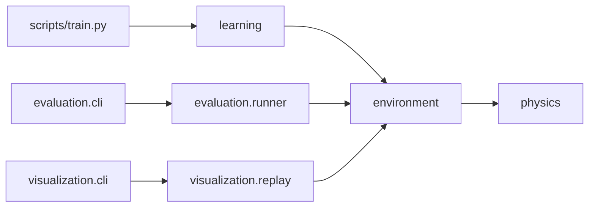

# Khảo sát bộ tài liệu dự án mma_ai

- [Mục tiêu và phạm vi](#muc-tieu-va-pham-vi)
- [Điểm neo](#diem-neo)
- [Kiến trúc hiện hữu](#kien-truc-hien-huu)
- [Blast radius](#blast-radius)
- [Bản đồ hành vi](#ban-do-hanh-vi)
- [Nợ, cạm bẫy và phần chưa kiểm](#no-cam-bay-va-phan-chua-kiem)

## Mục tiêu và phạm vi

Khảo sát để đặc tả README, giấy phép MIT, hướng dẫn đóng góp, nhật ký thay đổi và ba hướng dẫn sử dụng; mã nguồn, hệ thống tích hợp liên tục (CI) và `deliverables/` nằm ngoài vùng sửa. Các điểm vào (entry point) là giao diện dòng lệnh (CLI); điểm kiểm tra (checkpoint) và tập phim (episode) là hai loại đầu vào của hướng dẫn. `pyproject.toml:5-31` xác nhận tên, phiên bản, Python và nhóm phụ thuộc. `[đo: git ls-files README.md LICENSE CONTRIBUTING.md CHANGELOG.md 'docs/guides/**'` trả 0 dòng] xác nhận các đầu ra chưa được theo dõi trên HEAD `629550d`.

- Tự chốt: tài liệu nền tảng mô tả Linux/WSL2 là môi trường hiện có, Windows/macOS là việc đang đặc tả ở `specs/006-cross-platform-support/spec.md:54-58` — lý do: mã còn nhập `resource` theo POSIX tại `src/mma_ai/learning/resources.py:8`.

## Điểm neo

| Điểm neo | Vai trò | Bằng chứng `file:line` hoặc truy vấn |
|---|---|---|
| F-001 | Khai báo gói và nhóm cài đặt | `pyproject.toml:5-31` — Python 3.11–3.12; base MuJoCo/myo-sim/Gymnasium; nhóm `rl`, `eval`, `dev`. |
| F-002 | Điểm vào huấn luyện | `scripts/train.py:1-9` gọi `mma_ai.learning.cli.main`; cờ `--stage`, `--seed` ở `src/mma_ai/learning/cli.py:64-75`. |
| F-003 | Điểm vào đánh giá | `src/mma_ai/evaluation/cli.py:58-93` khai `--checkpoint` bắt buộc và cờ bổ sung; `main` gọi `evaluate_checkpoint` tại `src/mma_ai/evaluation/cli.py:221-226`. |
| F-004 | Điểm vào phát lại/demo | `src/mma_ai/visualization/cli.py:25-41` gọi `run_replay`; `src/mma_ai/visualization/replay.py:93-110` khai hai chế độ `--episode`/`--checkpoint`. |
| F-005 | Điểm vào đo hiệu năng | `src/mma_ai/learning/benchmark.py:381-429` khai `--seed`, `--repeats`; `main` ở `src/mma_ai/learning/benchmark.py:432`. |
| F-006 | Nguồn cấu trúc tài liệu | `docs/MAP.md:16-20` nối các spec M0–M1 với physics/environment/learning/evaluation/visualization; `pyproject.toml:34-46` đóng gói `src/mma_ai`. |

GitNexus đã chạy `query(search_query="train elbow CLI evaluation checkpoint replay episode benchmark")` và `context` cho `evaluation.cli:main`, `evaluation.runner:evaluate_checkpoint`, `visualization.replay:run_replay`, tất cả với `repo: "/mnt/01DCE9A4D6522BD0/Project/AI/fighterl"`; kết quả xác nhận các cạnh F-003/F-004 và mã nguồn tương ứng.

## Kiến trúc hiện hữu

Cạnh `Train → Learn` ở `scripts/train.py:3-9`; `Eval → Runner` ở `src/mma_ai/evaluation/cli.py:221-226`; `Replay → Vis` ở `src/mma_ai/visualization/cli.py:38-41`; `Runner → Env` ở `src/mma_ai/evaluation/runner.py:36-38`; `Vis → Env` ở `src/mma_ai/visualization/replay.py:463-468`; `Env → Physics` ở `src/mma_ai/environment/single_agent.py:37`. Cụm primary cho tài liệu là bốn điểm vào F-002…F-005; `pyproject.toml:20-31` là shared dependency. Không có HTTP route: `[đo: GitNexus route_map(repo="/mnt/01DCE9A4D6522BD0/Project/AI/fighterl") → total 0]`.

## Blast radius

| Thay đổi tài liệu | Callers/callees và phạm vi | Test cần đối chiếu | Rủi ro |
|---|---|---|---|
| README và hướng dẫn train | F-002 → `learning.cli.main` → cấu hình/môi trường; `[đo: GitNexus impact(target="src/mma_ai/learning/cli.py", direction="both", depth=2, includeTests=true)]`. | `tests/integration/test_train_script.py:1`; `tests/integration/test_train_stage.py:1`. | Ghi sai stage hoặc cách nhận checkpoint (`src/mma_ai/learning/cli.py:64-92`). |
| Hướng dẫn đánh giá | F-003 → `evaluate_checkpoint` → `check_disjoint`, rollout, report; `[đo: GitNexus context(name="evaluate_checkpoint", file_path="src/mma_ai/evaluation/runner.py")]`. | `tests/integration/test_evaluate_cli.py:1`; `tests/integration/test_evaluate_bad_checkpoint.py:1`; `tests/integration/test_evaluate_leakage.py:1`. | Checkpoint ngoài run cần `--out` (`src/mma_ai/evaluation/cli.py:70-74`); rò dữ liệu thoát 5 (`src/mma_ai/evaluation/runner.py:219-223`). |
| Hướng dẫn phát lại | F-004 → `run_replay` → episode/viewer; `[đo: GitNexus context(name="run_replay", file_path="src/mma_ai/visualization/replay.py")]`. | `tests/unit/test_episode.py:1`; `tests/unit/test_viewer.py:144`; `tests/integration/test_replay_viewer_real.py:207`. | Cần chọn đúng một chế độ (`src/mma_ai/visualization/replay.py:219-235`); màn hình vắng trả 7 (`src/mma_ai/visualization/replay.py:451-458`). |
| Mô tả benchmark | F-005 → chạy đo và ghi JSON; `[đo: GitNexus impact(target="src/mma_ai/learning/benchmark.py", direction="both", depth=2, includeTests=true)]`. | `tests/integration/test_benchmark_train.py:307`. | `--repeats` phải ≥5 (`src/mma_ai/learning/benchmark.py:446-450`). |

Tầng trực tiếp là CLI/runner ở bảng; tầng gián tiếp là environment, physics, checkpoint và report được GitNexus `impact` thấy cho F-003/F-004. Đây là thay đổi tài liệu nên rủi ro là sai lệnh hoặc sai cam kết, không có thay đổi hành vi mã. `[đo: GitNexus api_impact(file="src/mma_ai/evaluation/cli.py") và api_impact(file="src/mma_ai/visualization/replay.py") đều trả "No routes found"]`.

## Bản đồ hành vi

| Lệnh | Đầu vào và kết quả thực tế | Ca biên (edge case) |
|---|---|---|
| `python scripts/train.py --stage elbow --seed 42` | `scripts/train.py:3-9` gọi CLI; stage `elbow` được nhận tại `src/mma_ai/learning/cli.py:251-257`; tạo môi trường train ở `src/mma_ai/learning/cli.py:272-278`. | Stage khác trả 3; cấu hình sai trả 2 (`src/mma_ai/learning/cli.py:251-270`). |
| `python -m mma_ai.evaluation.cli --checkpoint <ckpt>` | Nhận `.pt` hoặc `latest.json` (`src/mma_ai/evaluation/cli.py:58-62`); runner kiểm tra checkpoint, manifest, ranh giới tập trước rollout rồi công bố báo cáo (`src/mma_ai/evaluation/runner.py:200-208`). | Checkpoint ngoài run cần `--out` (`src/mma_ai/evaluation/runner.py:210-223`); chart thiếu trả 6 (`src/mma_ai/evaluation/cli.py:231-238`). |
| `python -m mma_ai.visualization.cli --episode <tệp>` hoặc `--checkpoint <ckpt>` | Chọn một chế độ (`src/mma_ai/visualization/replay.py:219-235`); chế độ checkpoint tạo episode và chỉ ghi tệp khi có `--save-episode` (`src/mma_ai/visualization/replay.py:483-530`), chế độ episode đọc tệp (`src/mma_ai/visualization/replay.py:339-343`). | Không có display trả 7 nếu không `--headless` (`src/mma_ai/visualization/replay.py:451-458`). |
| `python -m mma_ai.learning.benchmark --seed 42 --repeats 5` | `src/mma_ai/learning/benchmark.py:387-398` khai cờ; ghi JSON mặc định `logs/m1/benchmark_train.json` (`src/mma_ai/learning/benchmark.py:411-415`). | Ít hơn 5 lần lặp trả 2 (`src/mma_ai/learning/benchmark.py:446-450`). |

`[đo: trong worktree sạch tại HEAD 629550d, uv run --isolated python <bốn điểm vào> --help]` đều thoát 0; lệnh phát lại có cả `--episode` và `--checkpoint`. Đây là ứng dụng dòng lệnh, không có tải trọng (payload) HTTP hay mã lỗi HTTP (`route_map` ở trên). Bộ test không gồm `tests/e2e` thoát 0: 1272 passed, 116 skipped, 11 xfailed `[đo: uv run --isolated --with pytest pytest -q -p no:cacheprovider --ignore=tests/e2e]`.

## Nợ, cạm bẫy và phần chưa kiểm

- README gốc, giấy phép, CONTRIBUTING, CHANGELOG và `docs/guides/` chưa được theo dõi; `[đo: git ls-files README.md LICENSE CONTRIBUTING.md CHANGELOG.md 'docs/guides/**'` trả 0 dòng].
- Bản quyền MIT năm 2026 và tên tác giả là dữ liệu yêu cầu người dùng, không suy từ mã; vị trí ghi là `LICENSE` theo phạm vi yêu cầu. `pyproject.toml:5-9` chỉ có tên/phiên bản dự án.
- `dev` chỉ khai `pytest`, không khai `ruff` hoặc `mypy` (`pyproject.toml:29-32`); hướng dẫn đóng góp cần dùng `uv run --with ruff` và `uv run --with mypy` nếu nêu hai công cụ này.
- Mã có phụ thuộc đồ họa và POSIX (`src/mma_ai/visualization/replay.py:451-458`; `src/mma_ai/learning/resources.py:8,77-79`), nên tài liệu không thể hứa chạy native Windows/macOS. Phạm vi xử lý nằm ở `specs/006-cross-platform-support/spec.md:54-58`.
- CHƯA KIỂM: chạy huấn luyện đầy đủ hay mở cửa sổ 3D trên máy mới của người đọc; phép đo hiện tại chỉ xác nhận parser `--help` trong worktree sạch.
